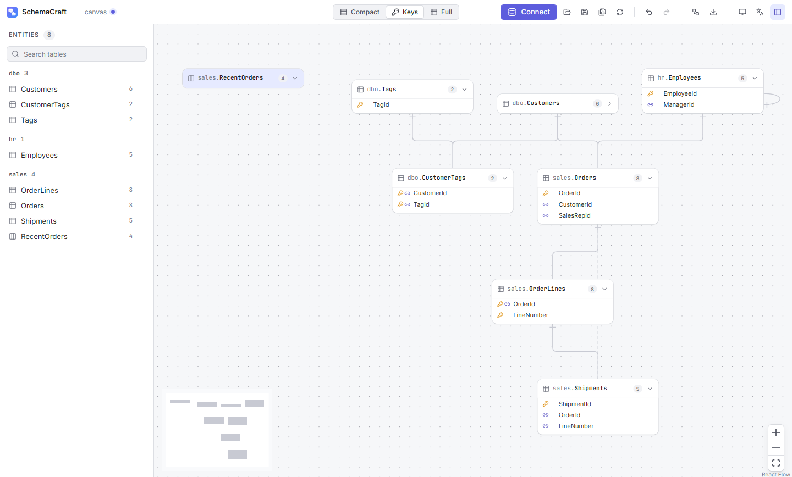

# SchemaCraft

Desktop CASE tool for database reverse engineering and entity-relationship diagram (ERD)
visualisation, built with Tauri 2, Rust and React. It connects to Microsoft SQL Server, extracts
the schema, keeps it in a portable `.scraft` project so the database is never queried twice for
the same diagram, and renders fast, interactive diagrams with high-fidelity single-page exports.



## Features

- **Reverse engineering of SQL Server.** Tables, views, columns and types, primary and foreign
  keys, indexes and check constraints, with SQL Server or Windows Authentication over encrypted
  connections. SQL Server 2019 and 2022 are tested; 2016 and 2017 are supported on a best-effort
  basis, without tests.
- **Honest with limited logins.** A login that sees only part of a database gets everything it
  can read, with what it cannot read marked as not available, never as missing, and an access
  report that names the cause and the one grant that would complete the schema.
- **Portable projects.** A `.scraft` file keeps the schema and the diagram, reopens without a
  database and refreshes from it with a reviewed diff that keeps your layout.
- **Interactive diagrams.** Entity cards at three detail levels, views told apart from tables by
  label, icon and colour, an entities panel with schema and kind sections, relationships in
  standard crow's foot notation, layered, organic and radial layouts, isolation of a table with
  its neighbours, undo and redo, and a command palette.
- **Inspector.** A panel beside the canvas with the selected table or view: columns with type,
  nullability, identity, computed and default, primary key, indexes, check constraints and the
  relationships in both directions, each fact marked when the login could not read it. The HTML
  viewer's detail panel is built from the same view-model, with the same sections, order and
  words, for what is on the exported diagram: it leaves out relationships to tables that are not
  on it, says "None on the diagram" for an empty relationship list and has no "Why?" links.
- **Readable rules.** Check constraints and foreign keys read as sentences in English or Spanish
  ("Each row in sales.Orders belongs to exactly one row in dbo.Customers"), with their columns
  highlighted on the diagram as you point at them and the SQL one click away. A rule SchemaCraft
  cannot read in full shows its SQL instead of a guess, in the app and in the HTML viewer alike.
- **Exports.** SVG with selectable text, a self-contained interactive HTML viewer, single-page
  PDF and PNG at 1x, 2x and 4x, all drawn by one renderer with bundled fonts.
- **Desktop quality.** English and Spanish, light and dark themes, keyboard access throughout, a
  portable executable of about 12 MB and a per-user installer.

## Download

Grab the latest release from the
[releases page](https://github.com/jmanuelsoberano/schemacraft/releases):

- `schemacraft-vX.Y.Z-windows-x64.exe`: the portable executable; nothing to install.
- `schemacraft-vX.Y.Z-windows-x64-setup.exe`: the per-user installer, which adds a Start menu
  entry and needs no administrator rights.
- `SHA256SUMS.txt`: checksums of both files.

Both need the Microsoft Edge WebView2 runtime, which Windows 11 and updated Windows 10 already
have; when it is missing, SchemaCraft says so and offers the download page. Releases are not
code-signed yet (see the code signing policy below), so SmartScreen shows a warning on the
first launch (More info, then Run anyway), and a PC with Smart App Control turned on refuses
unsigned executables.

## Code signing policy

Free code signing provided by [SignPath.io](https://about.signpath.io), certificate by
[SignPath Foundation](https://signpath.org).

The application to SignPath Foundation is under review; until it is approved, release files are
not signed.

- Committers and reviewers: [Manuel Soberano](https://github.com/jmanuelsoberano)
- Approvers: [Manuel Soberano](https://github.com/jmanuelsoberano)

The project has one maintainer, who holds every role. Changes reach `main` only through pull
requests that pass the required CI checks; the branch rules have no bypass list. On 2026-10-14
the history of `main` was rewritten once, with the branch rules paused for that push, to
replace the author email of earlier commits; no file changed, and pull requests #1 and #2 still
show the original commits. Contributions from others are reviewed with particular attention to
build scripts and workflows, and every signing request is approved by the maintainer.

Only the files that the release workflow builds from this repository are signed: the portable
executable and the installer attached to each GitHub release.

### Privacy policy

This program will not transfer any information to other networked systems unless specifically
requested by the user or the person installing or operating it.

SchemaCraft has no telemetry and no update check. It connects only to the SQL Server the user
specifies, and it opens Microsoft's WebView2 download page only when the user asks. Its
interface runs in the Microsoft Edge WebView2 runtime that Windows provides, whose diagnostic
data is covered by the [Microsoft Privacy Statement](https://privacy.microsoft.com/privacystatement)
and follows the Windows diagnostic data setting.

## Stack

- **Core:** Rust (`crates/schemacraft-core`), `serde`, `ts-rs`, `tiberius` with a `bb8` pool for
  SQL Server.
- **Host:** Tauri 2 (`src-tauri`), `tracing`.
- **Frontend:** React 19, TypeScript, Vite, React Flow, Radix primitives, Lucide icons, Zustand.
- **Quality:** Clippy with panic-free lints, rustfmt, ESLint (type-checked), Prettier, Vitest,
  GitHub Actions on Windows.

## Prerequisites

- Windows 10/11 with the WebView2 runtime (included in Windows 11).
- [Rust](https://rustup.rs) through rustup, which installs the toolchain pinned in
  `rust-toolchain.toml` (1.99.0, MSVC), plus the Microsoft C++ Build Tools.
- [Node.js](https://nodejs.org) 24 or newer with npm.

## Getting started

```bash
npm install
```

```bash
npm run tauri dev
```

The first Rust build takes a few minutes; later builds are incremental.

To produce the portable executable and the NSIS installer:

```bash
npm run tauri build
```

The portable binary is written to `target/release/schemacraft.exe` and the installer to
`target/release/bundle/nsis/`.

## Distribution

Every tag `vX.Y.Z` builds the assets listed under Download, smoke-tests the real executable and
publishes a draft GitHub release. [docs/release-checklist.md](docs/release-checklist.md) lists
what CI verifies and what is checked by hand before the draft is published. To cut a release: set
the version in `package.json` and `Cargo.toml`, add the dated entry `## [X.Y.Z] - YYYY-MM-DD`
and its link to `CHANGELOG.md`, merge that change into `main` through a pull request, then tag
the merge commit `vX.Y.Z` and push the tag; the release workflow refuses a tag that is not on
`main`. The entry goes into the notes of the draft release, and CI fails a version without one.

The separate `verify-release.yml` workflow checks downloaded draft-release assets on a
disposable Windows Server 2022 runner with a fresh standard account. It verifies hashes, the
portable and installed application, per-user installation and removal, preserved synthetic data,
the WebView2 failure path and local Windows Authentication against an owned SQL fixture. After
uninstalling SchemaCraft, it opens the exported HTML in Microsoft Edge without a Tauri runtime
and with the page's network requests blocked. It does not rebuild or publish the release.
Its reports distinguish natural runtime absence from
an injected failure and record the UAC setting: a hosted image with UAC disabled cannot verify
interactive elevation prompts on Windows 10/11. Local Windows Authentication does not establish
domain or remote Kerberos behavior. See the [release checklist](docs/release-checklist.md) for
outcomes and remaining publication checks; the provisioning scripts are restricted to disposable
GitHub-hosted runners and must not be run on a workstation or self-hosted runner.

## Scripts

| Command                                                 | Purpose                                                    |
| ------------------------------------------------------- | ---------------------------------------------------------- |
| `npm run tauri dev`                                     | Run the desktop application with hot reload                |
| `npm run tauri build`                                   | Build the portable executable and the installer            |
| `npm run typecheck`                                     | Type-check the frontend                                    |
| `npm run lint`                                          | Lint the frontend with type-aware rules                    |
| `npm test`                                              | Run frontend unit tests                                    |
| `npm run format`                                        | Format the repository with Prettier                        |
| `npm run contracts`                                     | Regenerate TypeScript types from the Rust model            |
| `npm run contracts:check`                               | Fail if the generated TypeScript types are out of date     |
| `cargo test --workspace`                                | Run Rust tests (also regenerates the TypeScript contracts) |
| `cargo clippy --workspace --all-targets -- -D warnings` | Lint Rust with the project's strict rules                  |
| `node scripts/prepare-fonts.mjs`                        | Regenerate the TTF fonts bundled by the export renderer    |
| `node scripts/smoke-test-release.mjs <exe> [dir]`       | Start a release build and check its first screens          |
| `node scripts/release-notes.mjs [version]`              | Print the notes of a release from its `CHANGELOG.md` entry |

The smoke test sets `SCHEMACRAFT_REMOTE_DEBUGGING_PORT`, which makes any build of the application
open a Chrome DevTools Protocol port on localhost, so a script can drive the real executable.

## Integration tests against SQL Server

The core crate has integration tests that run against real SQL Server 2019 and 2022 instances.
They are skipped unless the `SCHEMACRAFT_TEST_MSSQL_*` variables are set; with
`SCHEMACRAFT_TEST_REQUIRE_SERVER=1`, as CI sets it, they fail instead. With Docker Desktop running:

```powershell
.\scripts\dev-sqlserver.ps1 start
```

```powershell
.\scripts\dev-sqlserver.ps1 env | Invoke-Expression
```

```powershell
cargo test -p schemacraft-core --test sqlserver_integration --test sqlserver_permissions --test sqlserver_code --test diagnostics_privacy -- --nocapture
```

The script starts SQL Server 2022 as `schemacraft-mssql` on port 14333. With `-Version 2019` it
starts SQL Server 2019 as `schemacraft-mssql2019` on port 14334, so both can run side by side;
pass it to `env` as well (`.\scripts\dev-sqlserver.ps1 env -Version 2019`). `env` also prints
`SCHEMACRAFT_TEST_MSSQL_MAJOR`, the major version the server must report (16 for 2022, 15 for
2019), which a test in each binary checks, so a run cannot test the wrong server. CI runs the
four binaries against both versions, in one job.

`sqlserver_integration` seeds six databases on the container: `SchemaCraftFixture`, covering
keys, indexes, constraints, alias types and views; `SchemaCraftFixtureChanged`, the same fixture
with the changes of `changes.sql`, which the refresh test reads; `SchemaCraftStress`, 200 tables
used to check the extraction time budget; `SchemaCraftCheckForms`, built from the golden check
constraints in `check_forms.json` and the scratch tables of `rule_facts.sql`, which pins the
forms SQL Server stores and the engine behaviour the readable rules rely on; `SchemaCraftCode`,
the views, triggers, procedures and functions of `code.sql`, against which the capability probe's
counts are checked; and `SchemaCraftProbeLocked`, one table that a test locks so that the probe's
sections that wait on it fail and report only their error number.
`sqlserver_permissions` seeds a database of its own, an empty one and one with denials made to
`public`, and reads them as low-privilege logins: `db_owner`, `db_datareader`, `VIEW DEFINITION`
only, a reader with the `VIEW DEFINITION` of one schema, `SELECT` on two tables, `CONNECT` only,
two variants of a schema `DENY` and a column `DENY`, plus, on SQL Server 2022, `VIEW DEFINITION`
with `VIEW SECURITY DEFINITION` denied, a permission 2019 does not have, and runs the capability
probe as several of them. It also pins procedure and function visibility with schema `SELECT`,
schema `EXECUTE` and `VIEW DEFINITION` with an `EXECUTE` denial. It creates these server logins itself, with the `schemacraft_` prefix
and a password made up for each run, so run it only against a disposable server such as these
containers. `sqlserver_code` reads the `SchemaCraftCode` fixture as the owner and as a reader,
checks parameters, table functions, view options, trigger events and firing order, encrypted and
invisible texts, both options and bound schema filters, and verifies that a denied
`sys.sql_modules` read keeps the tables and the saved code on refresh. `diagnostics_privacy` reads the same database as `sa`, as the `db_datareader` login and
as a login of its own that may not read `sys.check_constraints`, logs in with a wrong password
and opens a database the login cannot open, and checks that the diagnostic log's events hold
counts, timings, kinds and error numbers only, with no name of the fixture, login, host, password
or database. Windows Authentication cannot run in the Linux container. The separate
`verify-release.yml` workflow exercises it through the real application against an owned local
Windows SQL Server fixture. A successful application report establishes that local scenario;
it does not establish domain, remote Kerberos or delegation behavior. The
[release checklist](docs/release-checklist.md) records whether that verification has passed.

## Browser preview

`npm run dev` serves the frontend alone. Outside the desktop runtime simulated backends take
the place of the Rust commands, so the flows can be reviewed in a browser: use `localhost` to
connect, or `auth-fail`, `cert-fail`, `down` and `slow` as server names to see each failure. A
server name that contains `partial`, `nothing` or `empty` (for example `partial.example.com`)
connects as a login that sees part of the schema, no table or view, or an empty database.
Projects are kept in memory (open returns the last saved project or a sample), the history is
seeded with two connections, and the recent projects include samples read with full and with
partial access, an upgraded 1.0 file and a file from a newer version, which opens read-only.
Refresh shows a fabricated review with every kind of change, or, when the login sees more or
less than before, what appeared, what disappeared and what could not be checked.

## Project files and preferences

A `.scraft` file is pretty-printed JSON: a header with the format version, the oldest format a
reader needs (`minReaderVersion`) and the save time, the connection without its password, the
inspection options, the full snapshot and the diagram state. Since 1.2 the snapshot can also hold
the code of views, procedures, functions and triggers. That code is business logic and may contain
anything its authors wrote into it, credentials included, so treat a `.scraft` file like the source
code of the database; no export carries it. The snapshot also records what the
login that read it could see: its permissions in that database, including the name of its
database user, and the list of facts kept from an earlier read that it could not check. No export
carries the permissions or the database user. An HTML export carries the access verdicts (the
level and the coverage) and, for the objects on the diagram, the dates their kept facts were last
read, so its detail panel marks those facts as not checked since that date. SVG, PDF and PNG
carry neither, beyond the one-line note of a partial read, and draw what was kept like any other
object on the diagram. A project reopens
without a database; refresh reconnects through the connection dialog and shows the differences
before applying them, keeping the positions of surviving tables.

SVG, PDF and PNG carry trigger counts, with a solid badge for enabled triggers and a dashed
badge when all are disabled. Static files explain the badge and state when triggers were not
read. HTML also carries the names, events and states of freshly read triggers belonging to
visible tables and views, plus recorded WITH CHECK OPTION and indexed-view settings. View
Definition says "Not included in this file". No export carries module code or exports procedures
and functions as objects; their names may still occur in exported CHECK and DEFAULT expressions.
Trigger metadata kept without a fresh read is excluded from HTML and never counted as current.

The connection dialog enables "Read procedures, functions and triggers" and "Save their code in
the project" by default. The second option includes view code and can be turned off while keeping
the object metadata; turning off the first leaves out both. Both respect the schema filter, and
leaving out views also leaves out their code and triggers. Schemas containing only visible
procedures or functions are offered while the first option is on. Testing the same connection
and database again keeps the selection.

Table-function columns record the returned structure. Defaults on a function's internal
return-table variable remain in its SQL body; they are not read or saved as separate column
defaults.

A refresh keeps code it cannot check because of reduced permissions, a failed read or a timeout,
with the date it was last read. Its review distinguishes this from a database change and reports
a failed code read even when there was no saved code. Turning an option off or excluding a schema
is an explicit choice to omit that code: applying the refresh removes the previously saved facts
in that scope. Code comparison ignores line endings, spaces and tabs at line ends and blank edge
lines, while the project keeps SQL Server's original text. The first capture lists objects and
texts in aggregate instead of reporting each as added.

SchemaCraft 1.2 saves projects in format 3. It opens 1.0 and 1.1 projects and converts them when
they are saved. SchemaCraft 1.1 opens a project saved by 1.2 read-only, without its code, and 1.0
cannot open it at all. A project saved by a newer version opens read-only when that version allows
it: it can be rearranged and exported, but not saved or refreshed. Data this version does not
understand is kept as it is when a project is saved.

Recent connections (never passwords) and recent projects are stored in `preferences.json`
inside the per-user configuration directory, `%APPDATA%\com.jmanuelsoberano.schemacraft` on
Windows. Delete the file to clear the history and the recent projects.

The interface also keeps two conveniences in the WebView2 local storage, under
`%LOCALAPPDATA%\com.jmanuelsoberano.schemacraft`; neither holds a secret:

- `schemacraft.settings`: the theme, the language, the entities panel's state and width, the
  Inspector's width, and the partial-access notices you closed.
- `schemacraft.connection`: the last connection form. The password is always blank; the server,
  login, database, schemas, the view and code options, encryption and certificate choice are
  kept.

Deleting `preferences.json` clears neither. Deleting the WebView2 data in that folder, with
SchemaCraft closed, resets both: the default theme and language return, closed notices show
again and the connection form starts empty, while the history, the recent projects and the
remembered passwords stay.

"Remember password" keeps a SQL login's password in the Windows Credential Manager (entries named
`sqlserver://<server>/<login>` under the `SchemaCraft` service) and never in any SchemaCraft file.
The history and a reopened project use it without asking; untick the box and connect again to
forget it, or remove the entry from the Credential Manager.

Since 1.2 SchemaCraft keeps a diagnostic log for bug reports in
`%LOCALAPPDATA%\com.jmanuelsoberano.schemacraft\logs`: one file per day,
`schemacraft.<date>.log` with the date in UTC, and `schemacraft-panic.log`, which records where a
crash happened. The folder keeps at most seven of these files: each start deletes the oldest
until six are left, then opens today's. The log holds versions, counts, timings, sizes, formats
and error kinds and numbers, such as how many tables an inspection read and how long each stage
took, and never a server, login, password, database, object name, path, SQL text or error
message. It is never sent anywhere. About (F1, or the version in the status bar) shows the folder
and opens it; read a file before you attach it to a bug report, and delete the folder, with
SchemaCraft closed, to clear the log.

## Logins with limited permissions

SchemaCraft reads only the catalog, with the permissions of the login you connect with. When
you choose a database it checks what that login can see and, if that is not everything, says so
before reading anything. A login that sees part of the schema, for example a member of
`db_datareader`, still gets
everything it can read: `CHECK` and `DEFAULT` expressions it cannot read show as "not
available", foreign keys to tables it cannot see are kept, and the status bar opens an access
report with the cause and a script a DBA can run, with the database and the login's database
user filled in:

```sql
USE [Sales];
GRANT VIEW DEFINITION TO [reporting];
```

`VIEW DEFINITION` gives no access to data and allows no change; on SQL Server 2022 and later it
also shows users, roles and permissions. SchemaCraft only copies the script and does not offer
it when an explicit `DENY` is the cause, because a grant does not lift a denial. The Inspector
marks every `CHECK`, `DEFAULT` or relationship the login could not read, and links a value not
available to this login, or a table not visible to it, to the report with "Why?"; a list there
says "None" only when it is complete. A login that sees no table or
view at all is told so and cannot start a read. Refreshing a project with a
login that sees less never removes what it cannot see: those items are kept and listed as not
checked. Code coverage is reported separately: `db_datareader` can see table functions and
triggers yet miss procedures and scalar functions. `VIEW DEFINITION` completes the code catalog
in its granted scope when no relevant denial prevents it. An encrypted module is identified as
encrypted, even for the owner, and CLR code has no SQL text to save. None of these code states
changes the table-access verdict or permits reading when no table or view is visible.

## Measuring a database without sharing it

Some databases cannot leave their owner's hands, yet how SchemaCraft fares on them still matters.
[`crates/schemacraft-core/probes/capability-probe.sql`](crates/schemacraft-core/probes/capability-probe.sql)
measures what SchemaCraft would read from a SQL Server database and prints numbers only, so you
can share the numbers and nothing else.

It is one read-only batch: SELECT statements on catalog views and system functions, under a lock
timeout of 5 seconds, that fill a table variable and return it. It reads no table data, calls no
procedure and changes nothing. Each row is a section, a metric and a number: objects per type,
the module texts of views, procedures, functions and triggers with their sizes in bytes, trigger,
parameter, index and constraint counts, the server version as numbers, whether the login holds
the permissions SchemaCraft checks, and timings in milliseconds. No name of any object, schema,
column, login, database or server and no definition text is ever returned: names and texts are
read on the server only to turn them into numbers, such as sizes, permission checks, pattern
matches and counts. A section that fails shows only its error number. Error 1222 means another
session held a lock for more than 5 seconds, usually an open transaction that changed the
schema; run the script again once it has ended. A text scan, on by default, counts on the server
how many modules contain credential-like words such as `password` or dynamic SQL such as
`sp_executesql`, and returns no text; set `@scan_text` to 0 at the top of the script to skip it.

Open the script in SSMS or in Visual Studio Code with the MSSQL extension, connected with the
login SchemaCraft uses and with the database to measure as the current database, read it and run
it. With sqlcmd, from the root of the clone:

```powershell
sqlcmd -S <server> -d <database> -U <login> -i crates\schemacraft-core\probes\capability-probe.sql -s "," -W -r1 > <folder outside the repository>\probe.csv
```

`-r1` keeps sqlcmd's messages on the screen and out of the file. With `-o` instead, sqlcmd would
write any error into the file, and an error can name the server, the database or the login. If
sqlcmd prints anything, the run failed, so share nothing. Share the file only when every line
after the two header lines reads section,metric,number.

Keep the result outside the repository and share only the grid of numbers. A commented query at
the end of the file times the transfer of the module texts in SSMS; it returns those texts, so
follow its instructions and share only the two client statistics they name. CI runs the probe
against the test databases as the administrator and as logins with limited permissions, and
fails if it returns any label outside a pinned list ([ADR-040](docs/architecture.md)).

## Project structure

```
crates/schemacraft-core/   domain model, inspectors, project files, diff engine, export (no Tauri)
src-tauri/                 Tauri host: IPC commands, configuration, icons
src/app/                   application shell, actions, brand, global styles
src/features/              connection, project, canvas, inspector, export and other features
src/shared/                contracts, i18n, ipc, settings, ui primitives
src/viewer/                standalone viewer embedded in exported HTML files
assets/brand/              source artwork for the application icon
docs/                      PRD, architecture decisions, UX principles
```

## Documentation

- [Product requirements (PRD)](docs/PRD_SchemaCraft_v1.md)
- [Architecture page](https://jmanuelsoberano.github.io/schemacraft/architecture/): layers,
  components, data, flows and how to add a feature
- [Architecture decision records](docs/architecture.md)
- [UX principles and definition of done](docs/ux-principles.md)
- [Changelog](CHANGELOG.md)

## Contributing

Issues and pull requests are welcome; [CONTRIBUTING.md](CONTRIBUTING.md) explains the setup,
the quality gates and the conventions. Security problems go through [SECURITY.md](SECURITY.md).

## Author

Developed by Manuel Soberano.

## Acknowledgements

The canvas is built on [React Flow](https://reactflow.dev), with layouts by
[ELK](https://eclipse.dev/elk/) and [d3-force](https://d3js.org). UI primitives come from
[Radix](https://www.radix-ui.com) and icons from [Lucide](https://lucide.dev). Exports are
rendered with [resvg](https://github.com/linebender/resvg) and
[svg2pdf](https://github.com/typst/svg2pdf), and the bundled fonts are
[Inter](https://rsms.me/inter/) and [JetBrains Mono](https://www.jetbrains.com/lp/mono/), both
under the SIL Open Font License 1.1.

## License

SchemaCraft is free software, licensed under the
[GNU Affero General Public License, version 3](LICENSE). You may use, study, share and modify
it; if you distribute a modified version, or run one as a network service, you must offer its
source under the same license.
